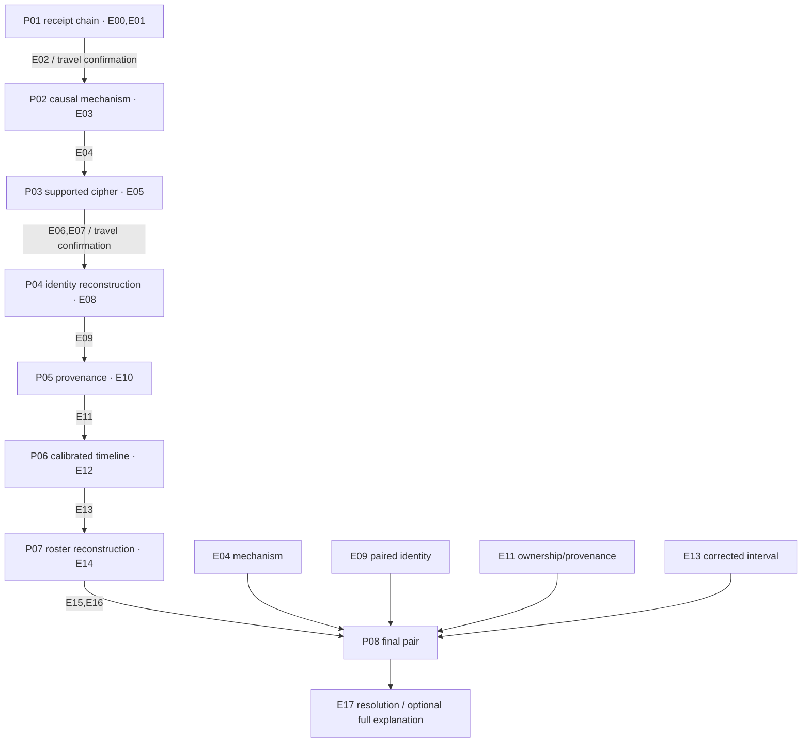

# DEVELOPMENT SPOILERS — phase 4 story and puzzle blueprint

**Design committed under the delegated brief, 2026-11-11.** This is the complete
architecture for phase 5 authoring, not a playable app or a request for player
approval. It supersedes the discarded stale-base draft. Do not include this
record, its title, its diagrams, or solution-bearing output in player preparation.

Authority: the confirmed brief, R01–R24, RD09–RD11 and the completed
[feasibility closure](../research/feasibility-closure.md). Machine-readable
dependencies and solution fixtures are in [blueprint.json](blueprint.json).
All case people, organizations, objects, transactions, logs and bench tests below
are fictional. Real documentary facts are attributed by fact ID and are never
presented as evidence that a real crime occurred.

## Case: The Hollow Register

The investigators review a private commission before a disputed shipment leaves
the fictional Lark Workshop. Two newly carved sandstone relief panels have
vanished from the expected custody chain. The external paperwork still appears
to describe an ordinary transfer. A proposed sale calls the consignment an old
civic relic. The players must reconstruct the missing identity and the first
unauthorized redirection, then name the actor and the order to stop.

There is no live deadline, actual shipment, police communication, external
submission or physical cache. A private dossier supplies the entire case. The
brewery, parks, city, historical organizations and their staff have no fictional
criminal role and have not agreed to participate. No real monument or artifact
is missing; in particular the real bell is contextual reference material only.

### Cast and truth

| Person | True role | Legitimate relevance | Resolution |
| --- | --- | --- | --- |
| Nadia Hart | Conservator | Handles inspection and packing | Can repack but cannot redirect the recipient |
| Luca Bellamy | Cataloguer | Describes material and provenance | Can amend descriptive metadata, not custody or release |
| Quinn Arden | Dispatcher | Arranges handoffs and order routing | Diverts both modern panels under the false historic description |
| Samir Cole | Courier | Handles the later transport | Relevant authority begins after the first diversion window |

The role/badge assignments are reconstructed in P07, not disclosed in early
player profiles. The designer knows the table; players initially know only
names and the records available at that point. There are no lying witnesses or
long interviews. All signed contribution, calibration and authority records are
reliable within the fictional case. The sale description is explicitly a
**claim under examination**, not an authoritative source or witness testimony.

Quinn withdraws an internal support cradle to bypass the externally intact
packing arrangement, redirects the two panels, and proposes selling a modern
commission with fabricated civic provenance. The support mechanism is established
by supplied fictional bench tests; real geology provides a causal comparison,
not an unsupported forensic law about actual sandstone objects.

The fair reframings are:

1. An intact external seal does not establish that the supported contents stayed
   in place; three controlled fictional tests distinguish possible mechanisms.
2. A shared modern location label does not erase separate original identities.
   The real two-quarry/one-lake history supplies the concept; the fictional
   inventory supplies the actual serials.
3. A material's age and an object's origin label do not date its manufacture or
   establish present custody. The real relocated-bell record is an analogy for
   provenance, not a claim that the private panels came from it.
4. The sender of a later handoff is not necessarily the actor at the earlier
   first-diversion interval. Corrected logs and reconstructed authority separate
   opportunity from a suspicious-looking role.

### True case chronology

Times are fictional **case time**, on one case day before the outing. They are
not tied to the phone clock, outing date, 15:00 departure, or a running timer.

- Two weeks before the case, Lark Workshop commissions two new relief panels,
  batch B17. The signed invoice identifies the new commission and its owner.
- Original inventory groups A and B retain serials K4 and M7. Later descriptive
  labels merge into one site alias; unrelated T9 and R2 are not the two panels.
- The last intact paired inventory is logged at service time 15:06. The first
  diverted inventory is logged at service time 15:14. The same service clock is
  four minutes fast, without drift: the act is **after 15:02 and by 15:10**.
- The relevant order, **O43**, lists K4 and M7, changes the receiver from Lark
  Workshop to Gannet Trading, and is issued at case time 15:06 by badge B2.
- B2 belongs to Quinn. It has both repack and redirect authority during that
  interval. Nadia lacks redirect authority; Luca lacks packing/release authority;
  Samir's comparable authority starts only at 15:11.
- The misleading historic sale description is defeated by the specific signed
  modern commission. Material use and a copied civic origin label cannot override
  that identity. The documented intent is a sale under false provenance; no
  speculative psychological motive or hidden relationship is necessary.

E16 expressly states that the relevant roster/logs are complete, badges individual
and unshared, actions immediate, and there is no delegation, queued change,
impersonation, collusion, offline substitution or tampering with the certified
records. These are disclosed **fictional case rules**, not claims about real
security technology. Adding any such possibility later requires redesigning the
deduction. The later courier order concerns a later stage and cannot explain
the earlier first diversion.

**Final submission:** two short fields, actor and order ID. Correct:
**Quinn Arden / O43**. Accept the full surname form or uniquely identifying
`Quinn`; accept `O43`, `O-43`, `order 43`, and `43` in the labeled order field.
Validate the pair atomically with a deliberate submit action. Do not demand a
written defense, four-part essay or exact motive wording. Then show a concise
resolution and an optional full explanation with evidence citations.

## Chapter, location and reveal architecture

| Chapter | Setting | Puzzles | Story function | Newly allowed navigation |
| --- | --- | --- | --- | --- |
| CH00 | L00, planned customer start | P01 | Establish the legitimate chain and correct research key | After P01, confirm L01's exact public destination |
| CH01 | L01, optional designated overlook visit | P02–P03 | Establish mechanism and decode the next reference/destination | After P03, confirm L05 and its northern public approach |
| CH02 | L05, ordinary recreation setting | P04–P05 | Recover the pair's identity and reject false provenance | None; remain at this stop |
| CH03 | Same L05 setting | P06–P07 | Establish the act window and reconstruct people/authority | None; no extra walk or drive |
| CH04 | Same permitted stationary setting | P08 | Combine the case and record the finding | End; no required return to start |

L02's main-beach approach, L03's civic setting and L04 are **not** destinations.
Their documentary facts can appear in the case without a visit. The exact L05
operator pin is F070, not the old main-beach pin F020. No puzzle depends on
standing at that pin, a numbered bay, staff, a sign, water, a bridge, GPS or a
feature visible after dark. References A02–A05 are supplied as the primary
certified factual inputs; the surroundings add context and optional comparison.

Evidence entry grants occur only when its puzzle becomes current; completion
grants occur only on correct submission or confirmed reveal. Future chapter
titles, objective prose, destinations, documents, alt text, map URLs and
notifications remain hidden in normal play. The app can download their files
without displaying them. Case-file revisits show only granted records.

## Shared puzzle contract

Every substantial puzzle has the eight fields of reasoning: objective, legitimate
inputs, signposted operation, defensible result, alternatives, escalating hints,
explained reveal, and consequences. JSON records below carry the exact IDs,
answers, hints, reveal explanations, timing targets and fallback contracts.

Text normalization: Unicode NFKC, case folding, trimmed/collapsed whitespace and
reasonable punctuation normalization; exact normalized aliases, not substring
acceptance or uncontrolled fuzzy matching. ID fields may normalize internal
spaces/dashes under their explicitly typed format. P06 parses paired times and
accepts 24-hour or explicit PM notation, including shared trailing PM. P04 checks
an unordered pair with no extras/duplicates. P07 checks the entire four-row map;
provide tap/select and accessible non-drag controls. P08 checks the whole final
pair and reports no per-field correctness. No attempts limit or wrong-answer
penalty. Empty/incomplete inputs request the missing entry without disclosing it.

Three hints are available immediately in sequence; reveal is a separate confirmed
action with the complete reasoning. Reference assistance supplies the full
legitimate inputs **without** a completed board, decoded text, highlighted answer
or automatic unlock. Correct and revealed completions grant identical evidence
and successors, retaining assistance flags only for the optional case recap.
No hint delay, countdown, mandatory score or unassisted final gate.

## P01 — reconstruct the first handoff

**CH00; L00; 6 minutes; documentary tracing.** E00 names job LC17, starting
seal H0, and the instruction to follow completed handoff references for that job.
E01 contains four receipts in deliberately mixed display order. For LC17,
H0 → J2 → K8 → R1. A K8 → R9 receipt belongs to LC71, not LC17.

The players follow exact job and seal IDs, not chronology inferred from torn
paper art. The terminal reference is **R1**. Full receipt text remains readable;
no tiny serial or obscured digit is essential. This is a simple opening deduction,
not an observation of the starting business. E02 confirms the falls destination
with operator name/pin, safe written arrival, and source F010/F013. There is no
search for a real-world envelope or staff interaction.

Alternatives: the other terminal belongs to another job; stopping at K8 ignores
the completed matching handoff. No arbitrary extraction, arithmetic or map
knowledge is needed. Hints progress from stable job IDs to separate chains to
following LC17 from H0 through K8. Reveal traces all three links and explains the
decoy before granting E02. Relevant evidence remains E00/E01 beside the task.

## P02 — identify the opening mechanism

**CH01; L01; 10 minutes; 6 minutes manipulation, 4 discussion.** E03 supplies
A02's source-backed conceptual erosion sequence, F011, and three fictional
controlled cradle tests. Optional observation is only from the designated public
overlook. Neither the app diagram nor a generated illustration claims to depict
a measured local rock section or a real inscription.

Arrange **shale erodes → support is lost → sandstone breaks away**. The causal
links are in the supplied source paraphrase. Then compare case observations
(intact external seal, lower contact trace, cradle removed) against three bench
profiles. Only **support withdrawal** matches all three. Impact breaks the
external seal and leaves an upper trace; water leaves a stain with the cradle
retained. This distinguishes hypotheses using given tests, not a claim that
natural erosion proves a particular crime.

Plausible alternative “impact” matches breakage alone but fails the two other
observations. “Water” confuses the setting with the supplied controlled result.
Accept `support withdrawal`, `support removal`, `cradle removal`, and
`removed support`. Require a valid causal arrangement plus the matching mechanism;
text/list controls offer the same operation without dragging. Three hints identify
the causal order, the need to compare all observations, then the lower-support
profile. Reveal explains both steps and grants E04, including the shale keyword
needed later. “Can't access this clue” opens the exact same complete reference
and bench inputs, not the solved sequence. No image load or visit is needed.

## P03 — decode and identify the next reference

**CH01; L01; 9 minutes; supported cipher and destination deduction.** E05's
fictional dispatch note explicitly defines a 5×5 Polybius protocol: key is the
foundation material from A02, unique key letters first, then unused A–Z, omit J,
fill by rows, read row then column. A local working grid can be filled/reset;
all instructions and the alphabet are available offline. E04/A02 is surfaced.

Key **SHALE** gives rows `SHALE / BCDFG / IKMNO / PQRTU / VWXYZ`.
Cipher pairs **11 12 13 14 14 35 52** decode to **SHALLOW**. One supplied reference
selector describes a shallower connection joining two former quarry basins;
the other selectors describe an isolated basin or a relocated object. The note
directs players to that matching reference's **northern public access**, not to
guess a destination from one adjective. A pre-departure confirmation then reveals
L05's exact operator name, written corridor and F070 pin. F021 validates the
documentary relationship, not a presently visible underwater boundary.

Accept the literal decoded word after normalization; no synonym guessing.
Reversed column/row convention is excluded by the note; I/J handling and fill
order are explicit. Hints cover the supported key, filling convention, then the
first two decoded letters and use of the descriptor. Reveal builds the grid,
decodes every pair, explains selector elimination, and grants E06/E07. A reference
route keeps the original unsolved cipher and complete instructions, never the
plaintext. Exact destination is confirmed before travel, without exposing later
case revelations.

## P04 — restore identities after a merge

**CH02; L05; 10 minutes; 8 manipulation, 2 discussion.** E08 supplies A03,
the real two-quarry/one-lake transformation (F021/F043), and a separately labeled
fictional inventory merge. The real diagram is conceptual, without invented
quarry names, surveyed boundaries, depths, compass relationships or present seams.

The fictional project has record groups A and B merged into one descriptive
site alias. Immutable serials and ownership persist. The retrieval instruction
requests every **relief panel, batch B17, owner Lark Workshop**. Group A holds
K4 (matching relief) and T9 (another owner's sample). Group B holds M7 (matching
relief) and R2 (packing material). Reconcile before/after ledger cards, preserving
the original group/serial joins, and select **K4 + M7**, either order.

The insight is that one later location label does not prove one object or allow
deduplication of original identities. The result follows from owner, kind and
batch, not from counting a real feature. T9 and R2 each fail a stated criterion;
one panel is incomplete, and any larger set includes an ineligible record.
References explain the merge while leaving every selection for players. Three
hints distinguish identity from alias, then require all retrieval criteria, then
point to the two groups' relief records. Reveal shows both joins and exclusions,
grants E09 and records the two serials automatically for later puzzles. Tap-select,
undo, reset and text/list alternatives replace required paper notes.

## P05 — test the provenance claim

**CH02; L05; 9 minutes; document/chronology deduction.** E10 supplies original
references A04/A05: sandstone has historic sharpening/building uses F050; the
city documents a bell's earlier origin and reinstallation F031 plus two park
dedications F032. These are contextual factual claims, not an attribution of
the private panels to the real bell or a present-day sign transcription.

The private signed commission explicitly describes the **new** B17 relief pair
made two weeks before the fictional case for Lark Workshop. A draft sale proposal
calls the same serials old civic salvage based only on their material and a
copied origin label. Choose the supported classification: **modern commission**.
The source date/identity of this particular commission defeats age inference
from sandstone or a relocated object's unrelated history. This is a short
argument from documents, not three long witness statements or a historical-date
password. The exercise also establishes that the only approved receiver in this
case is Lark Workshop; Gannet Trading is not on that authorization.

Accept `modern commission`, `new commission`, `contemporary commission`,
`newly commissioned panels`. “Historic civic salvage” is a claim to test;
“unknown” ignores the serial-linked signed new commission. Three hints separate
material and object, locate the serial-specific invoice, then compare its new
manufacture with the proposed historic label. Reveal explains identity, dating,
ownership and receiver scope, grants E11, and preserves the signed sources.
No local knowledge, actual bell inspection or obscure date recall is needed.

## P06 — bound the first diversion

**CH03; L05; 9 minutes; calibrated timeline.** E12 states one service clock
was four minutes fast for both relevant entries and did not drift. Last intact
paired inventory is 15:06 service time, first diverted inventory 15:14. Both are
on one fictional case day; no timezone, midnight or daylight-saving conversion.

Subtract four minutes: the act occurred **after 15:02 and by 15:10** case time.
Accept paired bounds `15:02–15:10` and `3:02–3:10 PM`; retain the open lower bound
and inclusive upper bound in E13. Do not invent an exact edit minute. The task
clearly requests case-time bounds rather than a rounded duration or the service
readings. Hints identify the shared calibration, correct subtraction direction,
then normalization of each entry. Reveal shows both calculations and why the
interval constrains later opportunity. E04/E09 and raw E12 remain surfaced;
there is no public-clock observation or player timer.

## P07 — reconstruct the access roster

**CH03; L05; 10 minutes; 4 manipulation, 6 reading/discussion.** E14 supplies
four concise reliable records and role definitions; no character lies:

1. Nadia checked out badge C4.
2. Samir was the courier; the courier checked out D9.
3. The cataloguer checked out A7.
4. Luca was neither courier nor dispatcher; the four roles and badges are
   one-to-one and Nadia's role was conservator.

Thus **Nadia/C4, Samir/D9, Luca/A7, Quinn/B2**. The role assignment leaves Luca
cataloguer and Quinn dispatcher. Reconstruct the entire four-row roster with
selectable name/badge chips or native selects; no arbitrary checksum word.
The whole mapping is checked together. The unique permutation is verified
exhaustively; if authoring changes a constraint, rerun that check.

Three hints use explicit fixed matches, then exclusions, then the remaining
one-to-one assignment. Reveal fills and explains every row, grants E15 (roster)
and E16 (complete authority/order packet), and leaves the finale for players.
No field-by-field correctness hint is used as an answer oracle. Reference access
shows all records and blank working rows, not the completed roster.

## P08 — record the finding

**CH04; L05; 9 minutes; final synthesis, no new essential evidence.** Surface
E04,E09,E11,E13,E15,E16 automatically. E16 defines starts inclusive, ends
exclusive, and the closed-case rules. The documented mechanism requires both
**repack and redirect** authority; review alone and later transport are insufficient.

| Badge | Authority relevant to the act | Case-time validity |
| --- | --- | --- |
| C4 | repack only | 14:50–15:30 |
| A7 | catalogue review only | 14:50–15:30 |
| B2 | repack and redirect | 14:50–15:30 |
| D9 | repack and redirect for the later handoff | 15:11–15:30 |

| Order | Payload | Receiver | Issued case time / badge | Why it fits or fails |
| --- | --- | --- | --- | --- |
| O18 | K4,M7 | Lark Workshop | 15:04 / C4 | Retains the approved receiver; does not describe the diversion |
| O26 | K4,M7 | Gannet Trading | 15:12 / D9 | Later transport record; cannot cause the already-observed first diversion |
| O43 | K4,M7 | Gannet Trading | 15:06 / B2 | Pair, unauthorized receiver, window and required authority all match |
| O57 | K4,T9 | Gannet Trading | 15:06 / A7 | Wrong payload and no relevant authority |

Record **Quinn Arden / O43**. Later handoff participation alone does not establish
who made the earlier change; the puzzle identifies the first unauthorized act.
The case rules exclude shared badges, queued operations and unreliable certified
logs. No new confession is introduced after submission to rescue the deduction.

Hints: combine the specific pair/receiver rather than the historic label; compare
the corrected interval and both permissions; join the one fitting order's badge
to the reconstructed roster. Reveal cites every elimination and grants E17 with
the same ending as unassisted completion. The concise ending recovers the modern
pair's identity and stops the fictional order; an optional explanation connects
mechanism, merge, provenance and opportunity. No real report or message is sent.

## Review verdict and phase 5 boundary

The design is complete under the delegated brief. Every puzzle has a supported
operation, alternatives, three hint steps, explained reveal, evidence/unlock
consequences and full input reference route. Six of eight puzzles emphasize
document discussion; manipulation occupies approximately 18 of the 72 solving
minutes (25%), spread across three short boards with no mandatory dragging.
Targets are estimates awaiting human timing, not tested difficulty claims.

Factual dependencies use only the six eligible Verified documentary inputs.
All physical comparison is optional; no claim is made that a sign/feature was
checked on site. The validator checks graph and finite solution logic. Phase 5
must still write complete player-facing prose, original assets, exact feedback,
evidence panels, and the offline resource inventory. Phase 6 builds the app.
Neither intended player is assigned spoiler-bearing testing.

## Phase 5 authoring review — 2026-11-11

The complete corpus, original references and source/asset inventories now exist
under `site/`. The separate [content review](../content-review.md) traces every
actual authored input, normal/reveal/reference continuity and ending, with
executed content/variant/resource checks and explicit test limits.

P03's surfaced inputs include E03 as well as E04/E05 so the original A02/F011
reference remains beside the decoding task. E05 separates its documentary F021
selector from its invented dispatch instructions. The blueprint records both
authoring corrections; the case, solutions, route and progression are unchanged.
Application controls/persistence/offline readiness remain phase 6 work.
